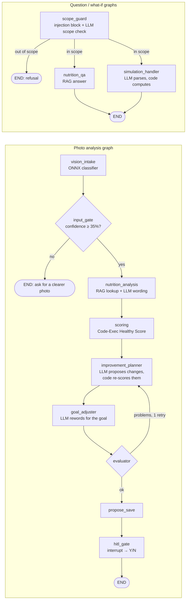

# Smart Plate Coach AI

**Plate Coach** is a single-purpose LLM agent: give it a photo of a meal and it identifies
the dish, looks up its nutrition, computes a 0–100 **Healthy Score**, and suggests small
improvements — each one re-scored by code, never guessed by the LLM. It also answers
nutrition questions and "what if" questions about the meal, and refuses everything else.

Built with **LangGraph** (workflow), **OpenRouter** (LLM provider, free and paid models)
and **LangSmith** (tracing), packaged as an interactive **CLI** and a standalone
**`agent.exe`**.

> General lifestyle information only — not medical or dietary advice.

The project has two parts (`docs/Smart_Plate_Coach_AI_Spec.pdf`):

- **Part A — Vision.** An EfficientNet-B0 food classifier (90 Food-101 classes), trained
  with transfer learning + fine-tuning, data cleaning, augmentation and an ablation study:
  **82.8% test accuracy** (0.827 macro-F1), up from a 61.1% baseline. See
  [`HOW_IT_WORKS.md`](HOW_IT_WORKS.md) and [`TRAINING.md`](TRAINING.md).
- **Part B — Agent.** The LangGraph agent described below, which uses Part A's model as its
  vision step. See [`HOW_AGENT_WORKS.md`](HOW_AGENT_WORKS.md).

---

## Quick start

### Option 1 — `agent.exe` (Windows, no Python needed)

1. Download `agent.exe` from the [latest release](https://github.com/BrachaBa/smart-plate-coach/releases/latest).
2. In the same folder, create a file named `.env` (copy [`.env.example`](.env.example)) and set
   `OPENROUTER_API_KEY` — get a key at <https://openrouter.ai/keys>. Optionally set
   `LANGSMITH_API_KEY` for tracing.
3. Run `agent.exe` from a terminal (or double-click it).

### Option 2 — from source

```bash
python -m venv venv
venv\Scripts\activate            # macOS/Linux: source venv/bin/activate
pip install -r requirements.txt  # agent only -- no torch needed
copy .env.example .env           # then fill in OPENROUTER_API_KEY
python -m agent.cli
```

The trained classifier ships in the repo as `agent/models/food_classifier.onnx` (exported
from Part A's `config4_full.pt`) and runs with `onnxruntime`, so nothing has to be trained.

## Using the CLI

```text
plate-coach> C:\photos\lunch.jpg
[INFO] Entering Node: vision_intake...
[INFO] Entering Node: input_gate...
[INFO] Entering Node: nutrition_analysis...
[INFO] Entering Node: scoring...
[INFO] Entering Node: improvement_planner...
[INFO] Entering Node: goal_adjuster...
[INFO] Entering Node: evaluator...
[INFO] Entering Node: propose_save...
[INFO] Entering Node: hitl_gate...

[HITL] The agent wants to save this meal (pizza, score 54) to your meal history:
       C:\photos\plate_coach_history.json
Proceed? [Y/N]: y
[INFO] Resuming Node: hitl_gate (approved)...

Identified: pizza (88% confident)
Healthy Score: 54/100
Breakdown: {'protein': 100, 'veg': 15, 'carbs': 90, 'sugar': 65, 'sat_fat': 0}
Profile: carbs: high, veg: low, protein: moderate

Suggestions:
  - You could add a side salad to help control portions (projected: 59/100)
  - Consider swapping a pizza slice for grilled chicken to reduce calories (projected: 77/100)

[COST] Cost of this task:
  nutrition_analysis      201 in / 1180 out   $0.000000  (theoretical $0.000250)
  improvement_planner     312 in / 2507 out   $0.000000  (theoretical $0.000523)
  goal_adjuster           182 in / 1662 out   $0.000000  (theoretical $0.000345)
  TOTAL                   695 in / 5349 out   $0.000000  (theoretical $0.001118)   [3 LLM calls]

what-if> what if I swap the pizza for a greek salad?
```

| Command | What it does |
|---|---|
| `<image path>` | Analyze a meal photo (drag a file into the terminal; quotes are fine) |
| `<question>` | Nutrition question, e.g. `how much protein is in sushi?` |
| *(after an analysis)* `what if …` | What-if simulation on that meal; empty line to go back |
| `history` | Trend summary over up to 20 photos, or over your saved meals |
| `export-summary` | Save a summary of the conversation to a `.txt` file (asks [Y/N] first) |
| `model [name]` | Show / switch the OpenRouter model |
| `status` | Model, API key, LangSmith tracing status |
| `cost` | Session total tokens and cost |
| `help`, `?` | Usage guide |
| `quit`, `exit` | Exit |

Errors are shown as one clear line — a wrong API key, an unknown model, a rate limit, no
credits, no network, a missing or unreadable image — never as a raw traceback (an
unexpected one is written to `plate_coach_error.log`).

## Architecture



| Requirement | Where it is |
|---|---|
| Focused task (not a general chat) | `scope_guard` refuses anything outside meal nutrition — see the scope eval |
| LangGraph workflow | `agent/graph.py` — five compiled graphs, conditional edges, a bounded retry loop |
| OpenRouter | `agent/llm.py` — `ChatOpenAI` on OpenRouter's API; free + paid models; automatic fallback between free models on a 429 |
| **GuardRails** | `scope_guard` (deterministic prompt-injection block, then LLM scope check); `agent/guardrails.py` rewrites prescriptive phrasing ("you must" → "you may want to") and adds the disclaimer |
| **Gates** | `input_gate` stops on a low-confidence photo; `scope_guard` routes refusals to END |
| **Evaluator** | `evaluator` checks the output (≥2 suggestions, at least one scored, no prescriptive language, no LLM-invented numbers) and sends its notes back to the planner for one retry |
| **HITL** | `hitl_gate` calls LangGraph `interrupt()` before *any* file write (meal history, conversation export); the CLI asks `[Y/N]` and resumes with `Command(resume=…)` |
| **RAG** | `agent/data/nutrition_facts.json` (105 foods, all 90 vision classes): retrieved by name for the meal and by text match for questions; the LLM answers only from the retrieved records |
| **Code-Exec** | `agent/tools.py` — Healthy Score, what-if deltas and projected scores are computed in Python; the LLM only decides *what* changes |
| LangSmith | Automatic tracing of every graph run and LLM call when `LANGSMITH_API_KEY` is set (`status` shows it) |
| Streaming | `stream_mode="tasks"` prints `[INFO] Entering Node: …` as each node starts |
| Cost & usage | Every LLM call is logged per node (`call_llm`); prices from OpenRouter's model list; free models also show a theoretical cost |

### Why the LLM never computes a number

Scores, calories and deltas are computed by deterministic code in `agent/tools.py`. The LLM
decides *which* food to add, remove or swap (as JSON), and the code decides what that means
numerically. LLM arithmetic is neither reliable nor reproducible, and a score a user may act
on has to be both. Details in [`HOW_AGENT_WORKS.md`](HOW_AGENT_WORKS.md).

## Evals

All three evals run the real graphs against OpenRouter and write CSVs to
[`evals/results/`](evals/results/). The vision step is pinned to a fixed dish in the meal
tasks, so every model gets identical input and differences come only from the LLMs.

```bash
python -m evals.compare_models   # quality (LLM-as-judge), time, reliability
python -m evals.cost_eval        # cost per step and per task, free vs paid
python -m evals.scope_eval       # refusal rate on out-of-scope questions
```

<!-- EVAL_RESULTS -->

## Tests

```bash
pip install pytest
python -m pytest tests -q
```

The offline suite (`tests/test_agent_offline.py`) runs every graph with a fake LLM — no key,
no network: strict nutrition lookup, all 90 classes covered, the HITL pause and decline,
scope refusals, the prompt-injection block, grounded and guardrailed answers, code-computed
what-ifs, and theoretical cost for free models.

## Building `agent.exe`

```powershell
powershell -ExecutionPolicy Bypass -File scripts\build_exe.ps1
```

Builds `dist\agent.exe` (~75 MB, single file, console) with PyInstaller from a torch-free
venv (`agent.spec`). Using ONNX instead of torch keeps the exe small. The spec also bundles
the build machine's current MSVC runtime: an older `msvcp140.dll` collected from a wheel
made `onnxruntime` crash on import.

## Project layout

```text
agent/
  cli.py              Interactive CLI (python -m agent.cli) -- streaming, HITL prompt, cost, errors
  graph.py            The LangGraph workflows (analysis, question, what-if, history, export)
  nodes.py            Graph nodes: scope guard, vision, gate, RAG, planner, goal adjuster, evaluator, HITL
  tools.py            RAG lookup + Code-Exec scoring / what-if deltas + approved file writes
  guardrails.py       Prompt-injection block, prescriptive-language rewrite, disclaimer
  llm.py              OpenRouter client, call_llm (per-node usage log, free-model fallback)
  pricing.py          Per-model prices from OpenRouter, per-step and theoretical cost
  vision_model.py     ONNX inference + EfficientNet-B0 preprocessing (no torch)
  state.py            Shared graph state
  models/food_classifier.onnx   The Part A classifier, exported
  data/nutrition_facts.json     Nutrition database (RAG source)
evals/
  compare_models.py   Eval 1 -- model comparison with LLM-as-judge
  cost_eval.py        Eval 2 -- cost per step / task / model
  scope_eval.py       Eval 3 -- out-of-scope refusal rate
  rubric.md           Judge rubric
  common.py           Shared task set and runner
  results/            CSV outputs
tests/                Offline test suite (fake LLM)
vision/               Part A: dataset, training, ablation, figures
scripts/              export_onnx.py (checkpoint -> ONNX), build_exe.ps1
manifest.json         Agent manifest (for the public agents platform)
agent.spec            PyInstaller spec for agent.exe
requirements.txt      Agent runtime   |   requirements-vision.txt  Part A training
.env.example          Required keys (OpenRouter, LangSmith) -- no real values
```

## Known limitations

- The classifier recognizes one dish per photo (90 Food-101 classes) and does not estimate
  portion size; every photo is treated as a medium portion.
- Nutrition values are typical per-100 g figures for each dish, not a measurement of the
  user's plate.
- Free OpenRouter models are frequently rate-limited upstream; the agent falls back to the
  next free model (`FREE_FALLBACK_MODELS`), and a paid model can be chosen with `model`.

## Authors

Bracha Babian · Rachel Israeli
